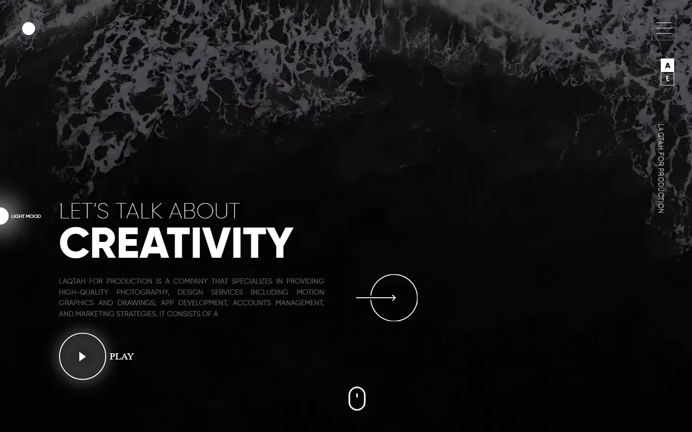

# Creative Laqta Site

A multi-page company website with a loading screen, scroll animations and several color themes that visitors can switch
between.

**[Live demo](https://devmaheremad.com/laqtasiteloader/)** · [More of my work](https://devmaheremad.com)



## What's inside
- **Seven pages:** home, about, services, works, project review, clients and contact.
- **Theme switching:** the visitor picks a color theme and the backgrounds, text, fills and strokes of every section
  follow it (`assets/js/script.js`).
- **Page loader** and **scroll animations** with AOS; sliders with Swiper.
- **Responsive layout** with Bootstrap 5.

## Stack
HTML · Sass (compiled CSS) · JavaScript · jQuery · Bootstrap 5 · AOS · Swiper

## Run locally
No build step. Open `index.html` in a browser, or serve the folder:

```bash
npx serve .
```

---

**Maher Almashharawi** · Senior Frontend Engineer (React, Next.js, TypeScript)
[devmaheremad.com](https://devmaheremad.com) · [Case studies](https://devmaheremad.com/case-studies/) · [LinkedIn](https://www.linkedin.com/in/devmaheremad) · hello@devmaheremad.com
